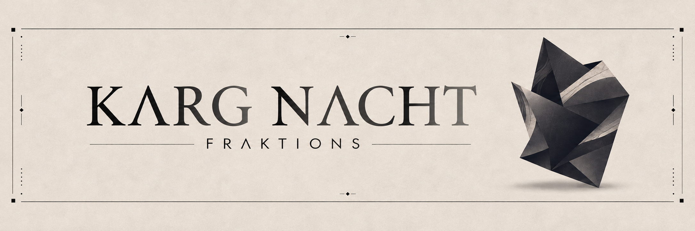

# KargNacht

**Independent developer** building desktop apps, AI tools, and game mods.

*Building things I want to exist.*

## Projects

| Project | What it does |
| --- | --- |
| [Rote Coding Fraktion](https://github.com/Karg-Nacht/Rote-Coding-Fraktion) | A Windows desktop workspace for AI-assisted coding with OpenCode. |
| [Rote Translate Fraktion](https://github.com/Karg-Nacht/Rote-Translate-Fraktion) | A Windows tray translator with a floating crystal, Markdown output, and support for online services and local models. |
| [Rote ASCII Fraktion](https://github.com/Karg-Nacht/Rote-ASCII-Fraktion) | A local desktop app for turning images and GIFs into text art on Windows and Linux. |
| [Larsta](https://github.com/Karg-Nacht/Larsta) | Self-hosted AI character chat for desktop and mobile, with English and Russian interfaces. |

## Mindustry

[Size Plus](https://github.com/Karg-Nacht/scheme-size-plus) adds schematic and building tools, overlays, and enemy routes. [Size God](https://github.com/Karg-Nacht/scheme-size-god) extends those tools with host controls, arena editing, and events. Both use the [shared Scheme Size source](https://github.com/Karg-Nacht/scheme-size).

[Telegram](https://t.me/KargFirtan)
